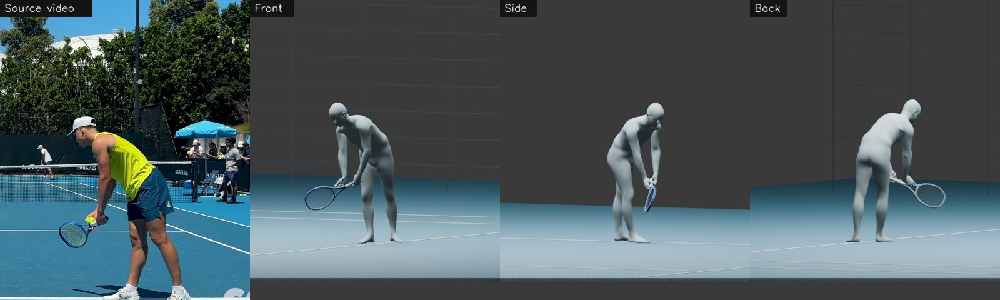
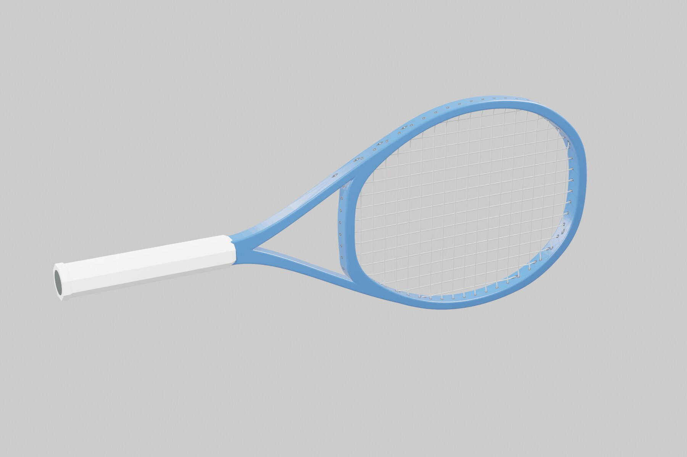
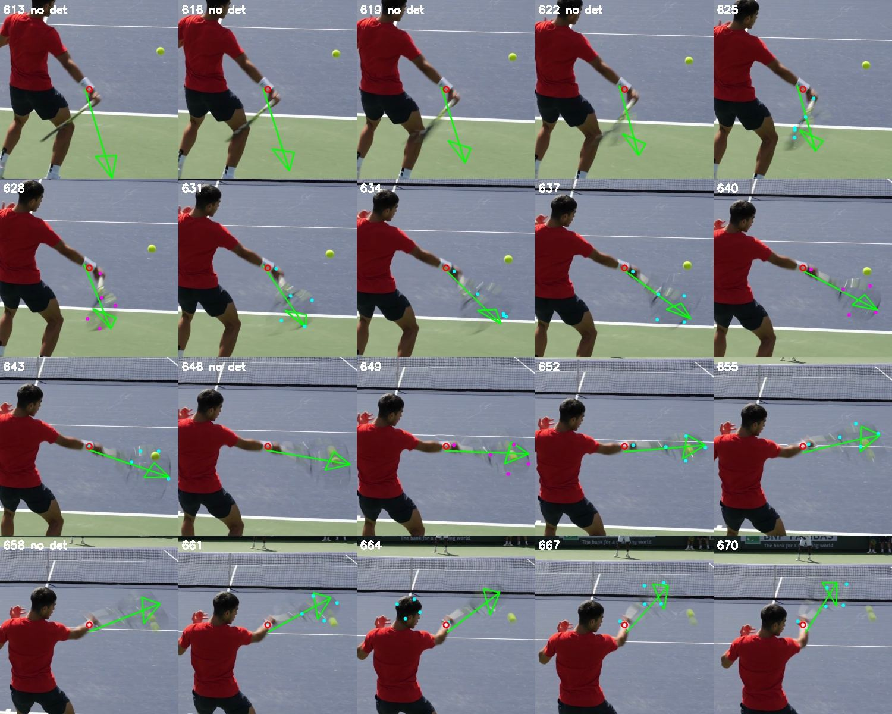
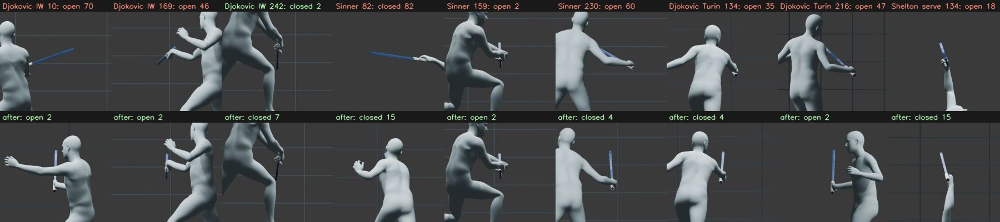
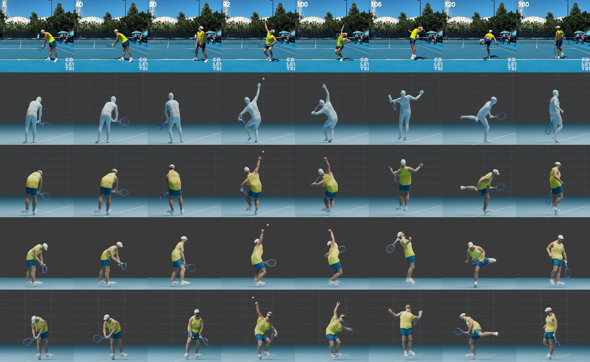

# Video to Motion

A visual library of what three paid AI services actually produced when turning tennis footage into 3D motion, rackets and bodies, over one month of work in October 2026.

- **Modal** running [FlowHMR](https://github.com/flowhmr/flowhmr) for body motion and [RacketVision](https://arxiv.org/abs/2511.17045) for racket detection
- **fal.ai** running Hyper3D Rodin 2.5, Kling 3.0, Hunyuan3D, Tripo, Flux and nano-banana
- **Meshy** 6 Lite and 7.1 for characters, crowds and heads

Every entry shows the input on the left and the output on the right. The gallery is a single static page: open `index.html`, or view it on GitHub Pages once enabled.



## What worked

**Video to body motion.** FlowHMR on court-level footage, filmed from behind with the player large in frame, gave body motion and shape that held up. Sixteen points across six players were rebuilt this way and play source, front, side and back in sync. Broadcast and high-seat footage gave a body but not a usable wrist or face.

**The racket.** Three parts had to come together:

1. A racket model built in Blender from reference contours: frame, throat bridge, individual grommets, a woven string bed and a wrapped handle as separate closed meshes.
2. RacketVision, which finds five racket points per frame where the racket is visible.
3. A solver that moves the racket through the arm instead of freely at the wrist. Forearm twist and wrist angle are kept inside anatomical limits and racket spin is capped at 2,500 degrees per second. This stopped the face flipping between frames.



**120 fps footage.** At 30 fps a fast swing is a blur and the detector loses the racket exactly when it matters. In 4K 120 fps footage it keeps the racket through contact and the follow-through: 81 percent of frames found against 32 to 40 percent at 30 fps. This was the single largest gain and cost nothing.



**Face angle at contact.** From behind, an open face and a closed face shrink the string outline by the same amount, so the detections cannot tell them apart. A contact rule pins the face for a few frames either side of contact, with different ranges for topspin and serves. 34 contacts were labelled by eye across the library.



## What partly worked

**Whole bodies from photos (fal.ai Rodin 2.5).** Two or three frames of the same video give a whole clothed person whose outfit matches the footage. The face is generated rather than a likeness, the generated hand stays open under the grip, and loose clothing is part of the body mesh so it bulges in some poses. Eight bodies were built; the player's own body is shown on the Shelton serve.



## What did not work

- **Meshy for likeness.** Fast and good for stylised characters, crowds and props from one reference image. Heads were rejected, hands came out as mittens, and the tennis figures were replaced.
- **Face reconstruction.** UP2You gave a connected body with clothing but the wrong identity. MICA gave face geometry with no hair, skin or body.
- **Kling 3.0 motion control** for AI video: both runs failed the anatomy check and the approach was dropped. No output was kept.
- **GEM-X and Kimodo** motion capture: loops came back but none was adopted.

## Repository layout

```
index.html        the gallery (built)
gallery.json      every entry: service, model, date, cost, verdict, inputs, outputs
build.py          regenerates index.html from gallery.json
media/library/    16 library clips (mp4 + poster), source | front | side | back
media/racket/     racket model renders, overlays, 120 fps proof, contact checks
media/bodies/     Rodin body comparison
media/calls/      input and output images for each service call
```

Rebuild the page after editing `gallery.json`:

```bash
python3 build.py
```

## Sources and limits

Footage comes from Court Level Tennis, Slow-Mo Tennis and TennisTV on YouTube, plus a college PlaySight camera; each library clip links to its source and time range. Clips are short excerpts used for analysis.

Body depth is monocular and no physics was simulated. The racket face angle at contact is set by rule, not measured. Hawk-Eye SkeleTRACK and mocap-suit capture remain the gold standard; this is what one camera and public footage can do.
